

  Tamanho do texto:
  <button onclick="diminuirFonte()" title="Diminuir texto" style="padding: 6px 12px; font-weight: bold; cursor: pointer; border: 1px solid #ccc; border-radius: 4px; background: #f8f9fa;">A-</button>
  <button onclick="resetarFonte()" title="Tamanho normal" style="padding: 6px 12px; font-weight: bold; cursor: pointer; border: 1px solid #ccc; border-radius: 4px; background: #f8f9fa;">A</button>
  <button onclick="aumentarFonte()" title="Aumentar texto" style="padding: 6px 12px; font-weight: bold; cursor: pointer; border: 1px solid #ccc; border-radius: 4px; background: #f8f9fa;">A+</button>
  
  <button onclick="window.print()" style="background-color: #0056b3; color: white; padding: 6px 16px; border: none; border-radius: 5px; font-size: 14px; cursor: pointer; box-shadow: 0 2px 4px rgba(0,0,0,0.2); margin-left: 10px;">
    🖨️ Imprimir ou baixar esta página
  </button>

PÚBLICO-ALVO: ANALISTAS, GESTORES E USUÁRIOS DO PAINEL PNCP EM NÚMEROS

# 3. Indicadores principais

## Cards de KPI's

Nos KPI's de contratações publicadas temos:

- Valor Publicado (Publicado - Vlr R$);
- Quantidade de itens Publicados (Publicado - Qtd Itens);
- Quantidade de Contratações Publicadas (Publicado - Qtd Contratações);
- Quantidade de Portais os quais foram feitas as publicações (Publicado - Qtd Portais).

Enquanto nos KPI's de contratações homologadas temos:

- Valor Homologado (Homologado - Vlr R$);
- Quantidade de itens Homologados (Homologado - Qtd Itens);
- Quantidade de Contratações Homologadas (Homologado - Qtd Contratações);
- Quantidade de Portais os quais foram feitas as homologações (Homologado - Qtd Portais).

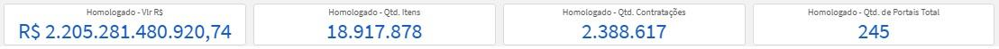

Esses indicadores gerais têm como objetivo fornecer uma visão rápida e consolidada do comportamento das contratações públicas registradas no PNCP, permitindo identificar o volume financeiro movimentado, a quantidade de contratações realizadas, o quantitativo de itens envolvidos e a abrangência dos portais utilizados. A comparação entre os valores publicados e homologados possibilita compreender a diferença entre a intenção inicial de contratação e os valores efetivamente contratados, servindo como ponto de partida para análises mais detalhadas ao longo do painel.

:::{important}
**Publicado ≠ Homologado.** O valor publicado representa a *intenção* de contratação; o valor homologado representa o que foi *efetivamente contratado*. A diferença entre eles é um dos principais indicadores de eficiência do processo licitatório.
:::

---

## Tendência temporal

Aqui temos um gráfico de linha temporal de Valor Total de Contratações x Data de Publicação que compara os valores publicados e homologados ano à ano. Os valores em Reais (R$) podem ser alterados para Quantidade de contratações Publicadas e Homologadas.

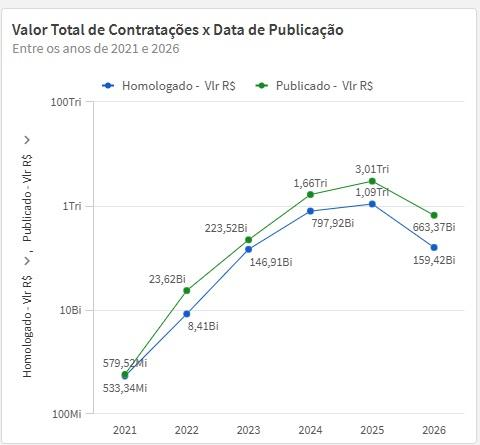

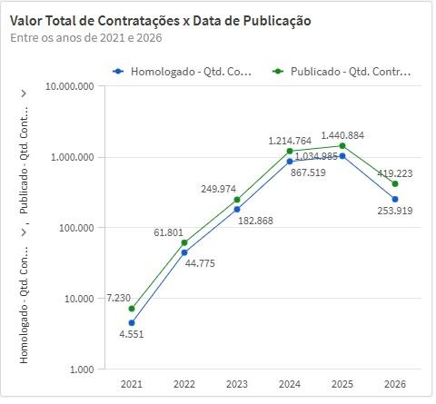

A ideia desse gráfico é verificar a evolução financeira e quantitativa das contratações ao longo dos anos, permitindo uma análise histórica do crescimento, redução ou estabilidade das compras públicas registradas no PNCP. A comparação entre os valores publicados e homologados ajuda a identificar o comportamento entre a intenção inicial de contratação e o volume efetivamente homologado, possibilitando observar tendências, mudanças de padrão ao longo do tempo e possíveis oscilações relevantes no volume de contratações públicas.

---

## Detalhamento por tempo e UF

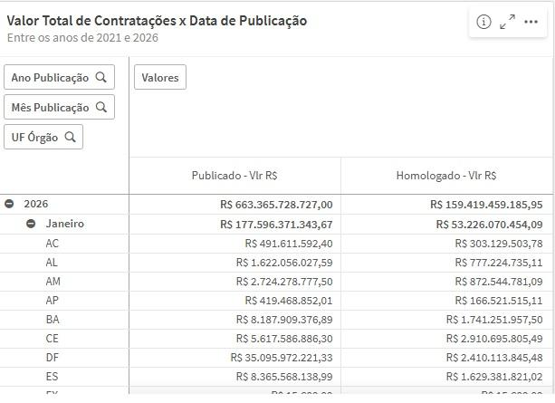

Aqui a visualização é de uma matriz que compara o valor publicado e homologado por ano de publicação, com um drill de mês de publicação, em seguida de UF do Órgão.

:::{tip}
Utilize o **drill-down** clicando no símbolo de seta para baixo (▼) no cabeçalho da matriz para aprofundar a leitura: **Ano → Mês → UF**. Para retornar ao nível anterior, clique na seta para cima (▲).
:::

Essa visualização oferece um comparativo detalhado dos valores financeiros publicados e homologados por UF do Órgão contratante, permitindo acompanhar a evolução das contratações ao longo do tempo em diferentes níveis de detalhamento. A funcionalidade de drill-down possibilita aprofundar a análise do ano para o mês e, posteriormente, para a unidade federativa, facilitando a identificação de padrões regionais, sazonalidades e concentrações de contratação em determinados períodos ou localidades.

---

## Relação entre Publicado vs. Homologado

Aqui temos um gráfico de dispersão onde cada ponto representa uma UF. Quanto mais à direita e acima, maior o volume financeiro de contratações publicadas e homologadas. Estados próximos da tendência geral apresentam maior equilíbrio entre valores publicados e efetivamente homologados.

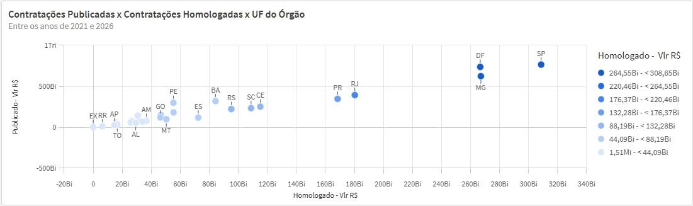

Essa visualização permite comparar o comportamento financeiro das contratações publicadas e homologadas entre as Unidades Federativas, possibilitando identificar estados com maior volume de contratações, padrões de concentração regional e diferenças entre os valores inicialmente publicados e os efetivamente homologados. Quanto mais próximo um estado estiver da tendência geral do gráfico, maior tende a ser a aderência entre os valores publicados e homologados, enquanto desvios mais acentuados podem indicar comportamentos específicos ou diferenças relevantes na execução das contratações públicas.

A partir deste ponto, a visualização e análise é dividida em duas frentes, **Total Publicado** e **Total Homologado**, que podem ser acessadas clicando nos botões correspondentes.

:::{attention}
Ao clicar em **Total Publicado**, todas as visualizações abaixo passam a exibir apenas dados de contratos publicados. Ao clicar em **Total Homologado**, exibem apenas dados homologados. Os dois modos são independentes — certifique-se de estar no modo correto antes de interpretar os gráficos.
:::

---

## Distribuições (mapa)

Aqui temos um mapa coloroplético do Brasil pelo valor publicado, onde a cor mais escura informa o estado (UF) com maior concentração de contratos Publicados.

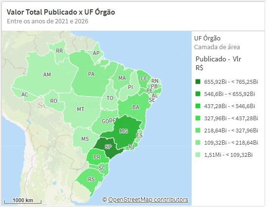

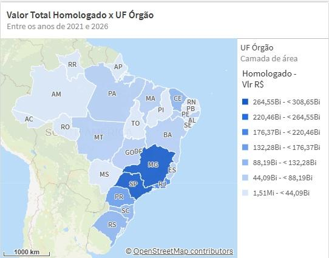

Essa visualização permite identificar a distribuição geográfica das contratações públicas entre os estados brasileiros, evidenciando as regiões com maior concentração financeira de contratos publicados e homologados. Quanto mais intensa a tonalidade apresentada no mapa, maior é o volume financeiro associado à respectiva Unidade Federativa. A análise espacial facilita a percepção de padrões regionais, concentração de investimentos públicos e diferenças de comportamento entre os estados, permitindo uma visão territorial mais clara da dinâmica das contratações públicas no país.

:::{note}
**Leitura do mapa coroplético:** quanto mais escura a tonalidade de um estado, maior é o volume financeiro de contratações associado àquela Unidade Federativa. Estados em cinza claro ou branco indicam baixo volume ou ausência de registros no período selecionado.
:::

---

## Comparações por dimensão – Esfera

Essa visualização é dividida em três que se alternam através de botões onde:

- **Esfera Governamental - R$**: mostra um gráfico de barras horizontais com os valores por esfera em reais (R$).
- **Esfera Governamental - %**: mostra um gráfico de rosca com os valores % derivada dos valores por esfera em reais (R$).
- **Esfera Governamental - Qtd**: mostra um gráfico de barras verticais com a quantidade de contratos por esfera governamental.

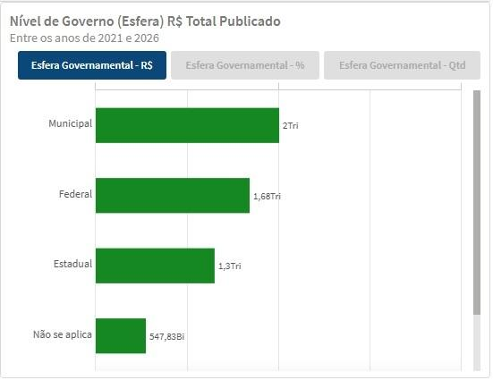

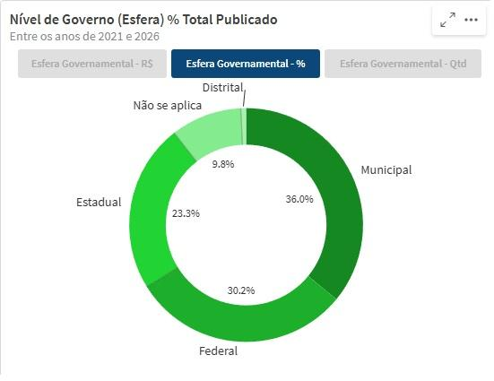

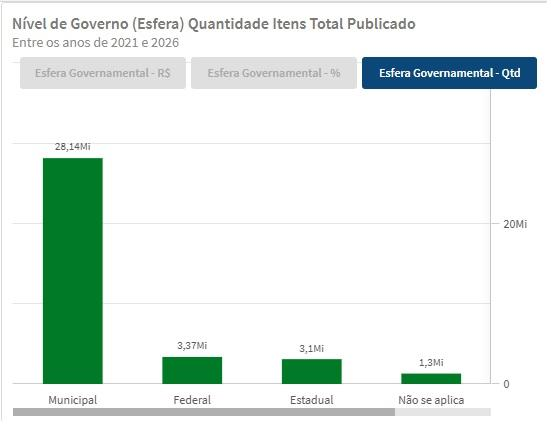

Essa análise permite compreender como as contratações públicas estão distribuídas entre as diferentes esferas governamentais — federal, estadual, municipal e demais classificações existentes na base do PNCP. A alternância entre valor financeiro, participação percentual e quantidade de contratos possibilita observar não apenas qual esfera movimenta mais recursos, mas também qual concentra maior volume de contratações. Essa combinação de perspectivas auxilia na identificação do perfil predominante das contratações públicas no país e evidencia diferenças de comportamento entre os níveis de governo.

---

## Comparações por dimensão – Modalidade

Temos aqui um gráfico tree map que plota os valores em reais (R$) pela Modalidade de Contratação (Pregão Eletrônico, Concorrência - Eletrônica, Inexigibilidade, Dispensa, Credenciamento, Concorrência Presencial etc.).

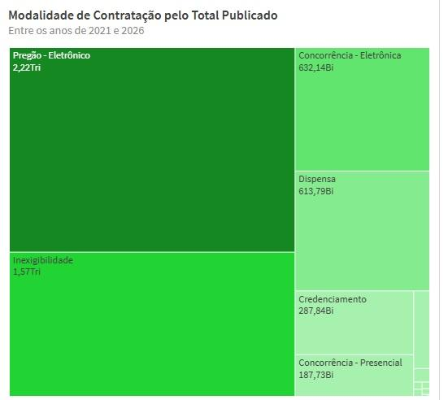

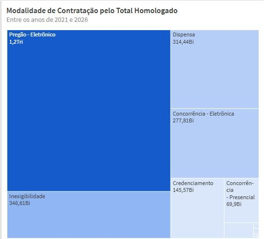

Essa visualização permite identificar quais modalidades de contratação concentram os maiores volumes financeiros dentro do PNCP, facilitando a compreensão sobre os mecanismos mais utilizados pela administração pública para realização das contratações. Quanto maior a área representada no gráfico, maior é o valor financeiro associado à respectiva modalidade. A análise auxilia na percepção da predominância de modalidades como Pregão Eletrônico, Dispensa e Inexigibilidade, além de permitir comparações rápidas entre os diferentes modelos de contratação utilizados pelos órgãos públicos.

---

## Comparações por dimensão – Situação

E por último temos o total publicado por Situação de Contratação. Essa visualização é dividida em três que se alternam através de botões:

- **Situação de Contratação - R$**: mostra um gráfico de barras horizontais com os valores por situação de contratação em reais (R$).
- **Situação de Contratação - %**: mostra um gráfico de rosca com os valores % derivada dos valores por situação de contratação em reais (R$).
- **Situação de Contratação - Qtd**: mostra um gráfico de barras verticais com a quantidade de contratos por Situação da contratação.

A Situação de Contratação pode ser: **Divulgada no PNCP**, **Suspensa**, **Anulada**, **Revogada**.

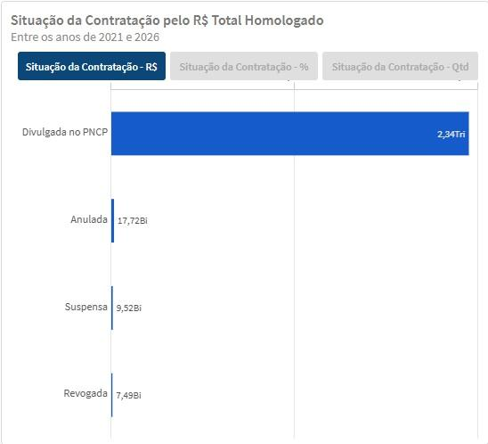

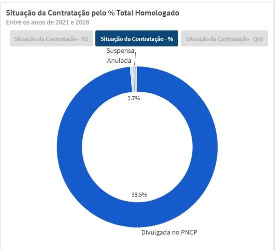

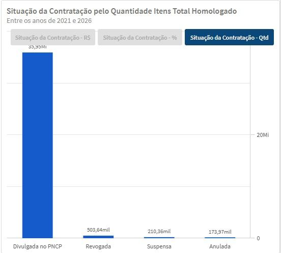

Essa análise permite compreender a distribuição das contratações públicas conforme a situação administrativa em que se encontram dentro do PNCP, evidenciando o volume financeiro, a participação percentual e a quantidade de contratos associados a cada status. A visualização auxilia na identificação da predominância de contratações efetivamente divulgadas no portal, ao mesmo tempo em que mantém transparência sobre processos suspensos, anulados ou revogados, possibilitando uma leitura mais clara do ciclo e da situação operacional das contratações públicas registradas na plataforma.

<a href="#">⬆️ Voltar ao topo</a>

  <button onclick="window.print()" style="background-color: #0056b3; color: white; padding: 10px 20px; border: none; border-radius: 5px; font-size: 16px; cursor: pointer; box-shadow: 0 2px 4px rgba(0,0,0,0.2);">
    🖨️ Imprimir ou baixar esta página
  </button>

