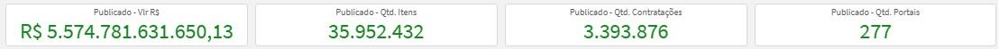
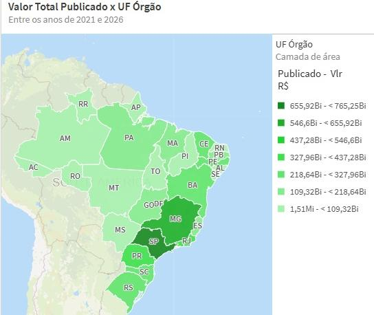
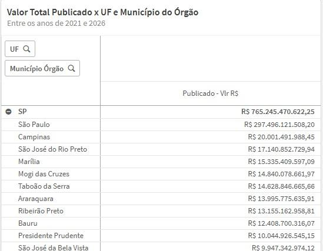
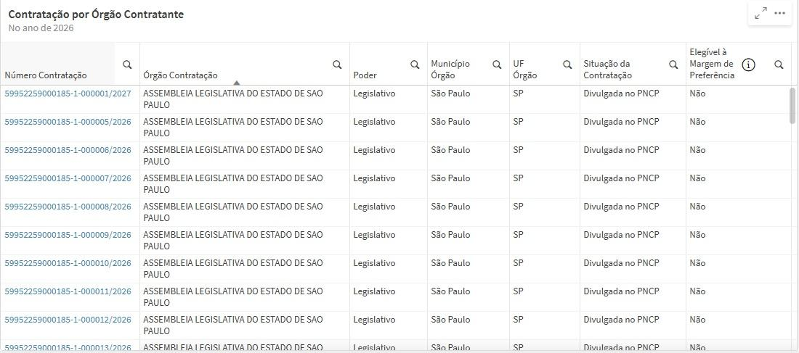
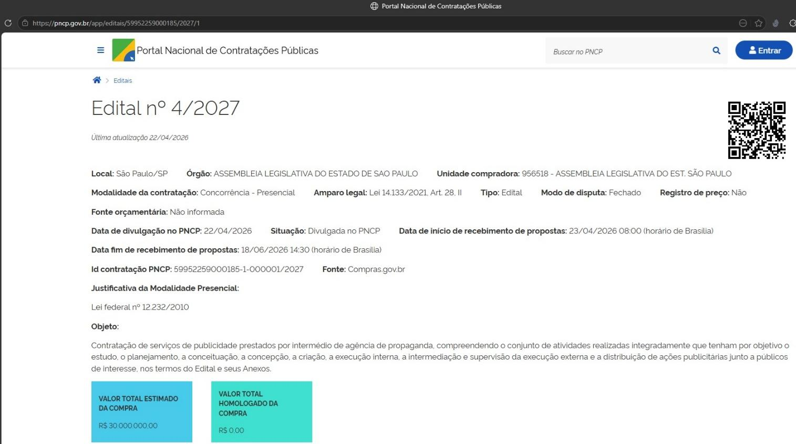
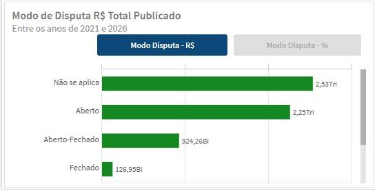
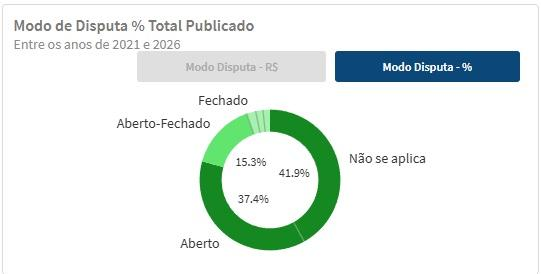

  Tamanho do texto:
  <button onclick="diminuirFonte()" title="Diminuir texto" style="padding: 6px 12px; font-weight: bold; cursor: pointer; border: 1px solid #ccc; border-radius: 4px; background: #f8f9fa;">A-</button>
  <button onclick="resetarFonte()" title="Tamanho normal" style="padding: 6px 12px; font-weight: bold; cursor: pointer; border: 1px solid #ccc; border-radius: 4px; background: #f8f9fa;">A</button>
  <button onclick="aumentarFonte()" title="Aumentar texto" style="padding: 6px 12px; font-weight: bold; cursor: pointer; border: 1px solid #ccc; border-radius: 4px; background: #f8f9fa;">A+</button>
  
  <button onclick="window.print()" style="background-color: #0056b3; color: white; padding: 6px 16px; border: none; border-radius: 5px; font-size: 14px; cursor: pointer; box-shadow: 0 2px 4px rgba(0,0,0,0.2); margin-left: 10px;">
    🖨️ Imprimir ou baixar esta página
  </button>

PÚBLICO-ALVO: ANALISTAS, GESTORES E USUÁRIOS DO PAINEL PNCP EM NÚMEROS

# 7. Indicadores principais

## Cards e KPI's

Nos KPI's de contratações publicadas temos:

- Valor Publicado (Publicado - Vlr R$);
- Quantidade de itens Publicados (Publicado - Qtd Itens);
- Quantidade de Contratações Publicadas (Publicado - Qtd Contratações);
- Quantidade de Portais os quais foram feitas as publicações (Publicado - Qtd Portais).

Esses indicadores gerais têm como objetivo fornecer uma visão rápida e consolidada do comportamento das contratações públicas registradas no PNCP, permitindo identificar o volume financeiro movimentado, a quantidade de contratações realizadas, o quantitativo de itens envolvidos e a abrangência dos portais utilizados, servindo como ponto de partida para análises mais detalhadas ao longo do painel.

---

## Distribuições (mapa)

Aqui temos um mapa coloroplético do Brasil com o valor publicado por UF do órgão contratante. A cor mais escura indica as Unidades Federativas com maior concentração financeira de contratações publicadas. Quanto mais intensa a tonalidade apresentada no mapa, maior é o volume financeiro associado à respectiva Unidade Federativa.

Essa visualização permite identificar a distribuição geográfica das contratações públicas publicadas no PNCP, evidenciando os estados com maior concentração de valores estimados. A leitura territorial facilita a percepção de padrões regionais e permite comparar o comportamento das publicações entre diferentes UFs.

---

## Matriz por UF e Município

Em seguida, a página apresenta uma matriz com o valor publicado, permitindo o detalhamento por UF do Órgão → Município do Órgão.

Essa visualização possibilita aprofundar a análise territorial, saindo da visão por estado para uma leitura municipal. Com isso, o usuário consegue identificar não apenas quais UFs concentram mais valores publicados, mas também quais municípios possuem maior participação dentro de cada estado.

A matriz é especialmente útil para análises locais, pois permite localizar concentrações de valores em municípios específicos e compreender como a distribuição das contratações publicadas se comporta dentro de cada Unidade Federativa.

---

## Tabela de Contratações por Órgão Contratante

A visualização apresenta uma tabela de detalhamento das contratações por órgão contratante. Essa tabela exibe informações operacionais importantes, como:

- Número da contratação;
- Link para o edital no PNCP;
- Órgão contratante;
- Poder;
- Município do órgão;
- UF do órgão;
- Situação da contratação;
- Elegível à margem de preferência.

Essa tabela permite que o usuário saia da visão agregada e acesse informações mais específicas sobre cada contratação publicada. O campo com o número da contratação contém link direto para o edital no PNCP, permitindo rastreabilidade e consulta à fonte oficial.

:::{tip}
Clique no número da contratação na tabela para acessar diretamente o edital publicado no **portal PNCP** (pncp.gov.br). Esse link garante rastreabilidade e permite consulta à fonte oficial sem necessidade de busca manual.
:::

No campo **Elegível à Margem de Preferência**, há um ícone de informação que abre uma visualização complementar. Essa visualização apresenta KPIs relacionados ao valor da margem de preferência, percentual do valor com margem de preferência e um gráfico de rosca com a distribuição percentual por amparo legal.

Essa funcionalidade ajuda a explicar, de forma mais detalhada, o impacto da margem de preferência nas contratações publicadas, sem sobrecarregar a tela principal com informações adicionais.

---

## Tendência temporal das contratações publicadas

A visualização apresenta um gráfico de linha de Valor Total de Contratações x Data de Publicação, mostrando a evolução dos valores publicados ao longo dos anos. A visualização em reais (R$) pode ser alternada para quantidade de contratações publicadas.

Essa análise permite acompanhar a evolução temporal das publicações no PNCP, identificando crescimento, queda, estabilidade ou variações relevantes no volume financeiro e na quantidade de contratações. O gráfico ajuda a compreender como o comportamento das publicações se altera ao longo do tempo e permite identificar períodos de maior concentração de registros.

---

## Tipo de Benefício

A visualização de Tipo de Benefício apresenta a distribuição das contratações publicadas conforme os benefícios associados aos itens. O gráfico possui duas formas de leitura:

- Gráfico de barras horizontais com valores em reais (R$);
- Gráfico de rosca com participação percentual.

Essa análise permite compreender quais tipos de benefício aparecem com maior relevância nas contratações publicadas, seja em valor financeiro absoluto ou em participação percentual. Com isso, o usuário pode identificar a presença de benefícios como participação exclusiva, cota reservada, subcontratação ou ausência de benefício, conforme a classificação existente na base.

---

## Portal de Contratação

O gráfico de Portal de Contratação apresenta o valor publicado por portal ou sistema de origem.

Essa visualização permite identificar quais portais concentram maior volume financeiro de publicações no PNCP. A análise é importante para compreender a origem dos registros e a participação relativa dos diferentes sistemas utilizados pelos órgãos públicos para publicação de contratações.

---

## Instrumento Convocatório

A visualização de Instrumento Convocatório é dividida em duas formas de análise:

- Gráfico de barras horizontais com valores em reais (R$);
- Gráfico de rosca com participação percentual.

Essa análise permite observar quais instrumentos são mais utilizados nas contratações publicadas e qual o peso financeiro de cada um no total analisado. Ela ajuda a compreender se as publicações se concentram em editais, atos autorizativos, chamamentos, avisos ou outros instrumentos registrados na base.

---

## Critério de Julgamento

A visualização de Critério de Julgamento também é dividida em duas formas de leitura:

- Gráfico de barras horizontais com valores em reais (R$);
- Gráfico de rosca com participação percentual.

Essa análise permite identificar quais critérios de julgamento concentram os maiores valores nas contratações publicadas, como menor preço, maior desconto, técnica e preço, entre outros. O objetivo é mostrar como os processos de contratação são estruturados quanto ao método de escolha da proposta vencedora.

---

## Modalidade de Contratação

A página apresenta um gráfico do tipo treemap com os valores publicados por modalidade de contratação, como:

- Pregão Eletrônico
- Concorrência Eletrônica
- Inexigibilidade
- Dispensa
- Credenciamento
- Concorrência Presencial
- Entre outras

Essa visualização permite identificar quais modalidades concentram os maiores valores financeiros nas publicações do PNCP. Quanto maior o bloco no treemap, maior é o volume financeiro associado à respectiva modalidade. A análise facilita a percepção da predominância de determinados modelos de contratação e permite comparar rapidamente o peso relativo de cada modalidade.

---

## Modo de Disputa

Por fim, a página apresenta as visualizações de Modo de Disputa, divididas em duas formas:

- Gráfico de barras horizontais com valor em reais (R$);
- Gráfico de rosca com participação percentual.

Essa análise permite compreender como as contratações publicadas se distribuem conforme o modo de disputa adotado, como aberto, fechado, combinado ou não aplicável. A visualização auxilia na compreensão da dinâmica competitiva dos processos de contratação e mostra quais formas de disputa têm maior representatividade financeira no universo analisado.

<a href="#">⬆️ Voltar ao topo</a>

  <button onclick="window.print()" style="background-color: #0056b3; color: white; padding: 10px 20px; border: none; border-radius: 5px; font-size: 16px; cursor: pointer; box-shadow: 0 2px 4px rgba(0,0,0,0.2);">
    🖨️ Imprimir ou baixar esta página
  </button>

