

  Tamanho do texto:
  <button onclick="diminuirFonte()" title="Diminuir texto" style="padding: 6px 12px; font-weight: bold; cursor: pointer; border: 1px solid #ccc; border-radius: 4px; background: #f8f9fa;">A-</button>
  <button onclick="resetarFonte()" title="Tamanho normal" style="padding: 6px 12px; font-weight: bold; cursor: pointer; border: 1px solid #ccc; border-radius: 4px; background: #f8f9fa;">A</button>
  <button onclick="aumentarFonte()" title="Aumentar texto" style="padding: 6px 12px; font-weight: bold; cursor: pointer; border: 1px solid #ccc; border-radius: 4px; background: #f8f9fa;">A+</button>
  
  <button onclick="window.print()" style="background-color: #0056b3; color: white; padding: 6px 16px; border: none; border-radius: 5px; font-size: 14px; cursor: pointer; box-shadow: 0 2px 4px rgba(0,0,0,0.2); margin-left: 10px;">
    🖨️ Imprimir ou baixar esta página
  </button>

PÚBLICO-ALVO: ANALISTAS, GESTORES E USUÁRIOS DO PAINEL PNCP EM NÚMEROS

# 11. Indicadores Nacionais Principais

## Indicadores-chave (KPIs)

No topo da página são apresentados os KPIs gerais das contratações homologadas:

- Valor Homologado — Homologado - Vlr R$
- Quantidade de Itens Homologados — Homologado - Qtd Itens
- Quantidade de Contratações Homologadas — Homologado - Qtd Contratações
- Quantidade de Portais com Homologações — Homologado - Qtd Portais

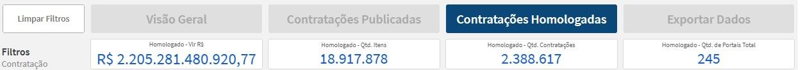

Esses indicadores apresentam uma visão consolidada do volume de contratações homologadas, permitindo compreender rapidamente o valor financeiro contratado, a quantidade de itens envolvidos, o número de contratações homologadas e a quantidade de portais responsáveis pelos registros. Eles funcionam como ponto de partida para a análise da página, orientando a leitura dos demais gráficos e tabelas.

---

## Indicadores específicos — ME/EPP

Em seguida, a página apresenta KPIs específicos relacionados às contratações homologadas com participação de ME/EPP.

:::{note}
**ME/EPP** significa **Microempresa / Empresa de Pequeno Porte**. Não confundir com MEI (Microempreendedor Individual), que é uma categoria distinta. O painel segrega esses indicadores para facilitar o acompanhamento das políticas de tratamento diferenciado previstas na Lei Complementar nº 123/2006.
:::

Indicadores apresentados:

- Valor Homologado ME/EPP — Homologado - Total ME/EPP;
- Quantidade de Itens Homologados ME/EPP — Homologado - Qtd Itens ME/EPP;
- Quantidade de Contratações Homologadas ME/EPP — Homologado - Qtd Contratações ME/EPP;
- Quantidade de Portais com Homologações ME/EPP — Homologado - Qtd Portais ME/EPP.

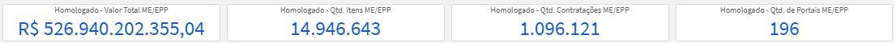

Esses indicadores permitem avaliar a participação das microempresas e empresas de pequeno porte nas contratações homologadas, tanto em valor financeiro quanto em quantidade de itens, contratações e portais. Essa leitura é importante para acompanhar a presença de fornecedores de menor porte no mercado público e verificar a representatividade desse segmento nos resultados homologados.

---

## Alternância entre Fornecedores Nacionais e Internacionais

A página possui uma divisão por botões que permite alternar entre:

- Contratações de Fornecedores Nacionais
- Contratações de Fornecedores Internacionais

Quando o usuário seleciona **Fornecedores Nacionais**, os gráficos e indicadores passam a exibir apenas os valores e quantidades vinculados a fornecedores nacionais. Quando seleciona **Fornecedores Internacionais**, a página apresenta os resultados relacionados a fornecedores estrangeiros.

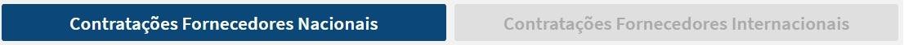

:::{attention}
A seleção entre **Nacional** e **Internacional** altera **todos** os indicadores e gráficos da página simultaneamente, incluindo KPIs, mapas, tabelas e tendência temporal. Verifique sempre qual modo está ativo antes de interpretar os dados.
:::

Essa alternância permite comparar a participação nacional e internacional nas contratações homologadas, possibilitando avaliar a origem dos fornecedores, a concentração territorial dos contratos, o volume financeiro associado e possíveis diferenças entre o perfil das contratações realizadas com fornecedores brasileiros e estrangeiros.

---

## Distribuição territorial — Mapa coroplético

No modo de fornecedores nacionais, a página apresenta um mapa coroplético do Brasil com o valor homologado por UF do órgão contratante. A cor mais escura representa as Unidades Federativas com maior concentração financeira de contratações homologadas.

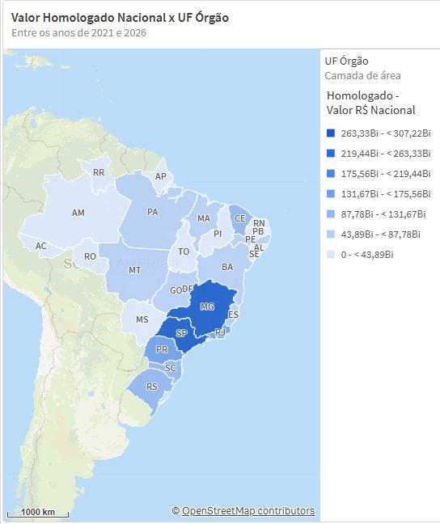

Essa visualização permite compreender a distribuição geográfica dos valores homologados no território nacional, evidenciando onde se concentram os maiores volumes financeiros contratados. A análise espacial facilita a identificação de padrões regionais, diferenças entre estados e concentração de contratações homologadas em determinadas Unidades Federativas.

---

## Matriz por UF e Município

A página apresenta uma matriz com o valor homologado, permitindo o detalhamento por UF Órgão e Município Órgão.

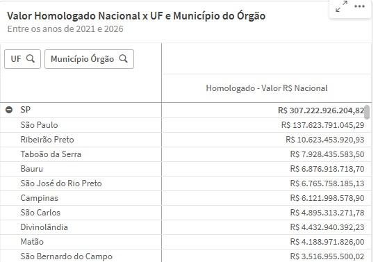

Essa visualização possibilita aprofundar a análise territorial, partindo da visão estadual para a leitura municipal. Com isso, o usuário consegue identificar quais municípios concentram os maiores valores homologados dentro de cada UF, permitindo uma investigação mais precisa sobre a distribuição local das contratações.

---

## Maiores fornecedores contratados

Logo abaixo, a página apresenta um gráfico de barras horizontais com os maiores fornecedores nacionais por valor homologado em reais.

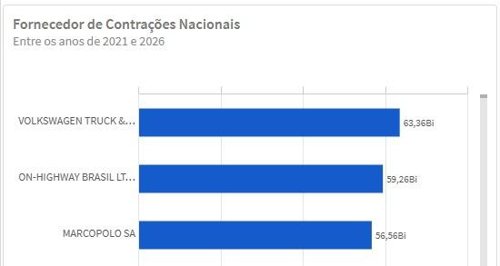

Essa visualização permite identificar os fornecedores que concentram os maiores valores contratados no período e no recorte selecionado. A análise é útil para observar concentração de mercado, fornecedores recorrentes e participação relativa dos principais contratados dentro do universo analisado.

---

## Tendência temporal das contratações homologadas

Temos agora um gráfico de linha de Valor Total de Contratações x Data de Publicação, mostrando a evolução dos valores homologados ao longo dos anos. A visualização em reais (R$) pode ser alternada para quantidade de contratações homologadas.

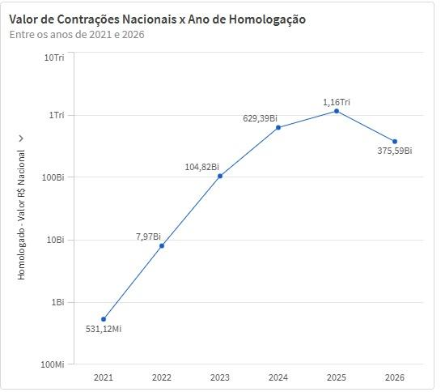

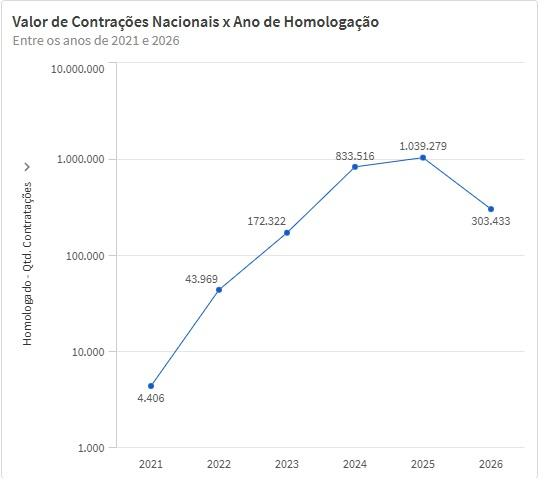

Essa análise permite acompanhar a evolução histórica das contratações homologadas, identificando crescimento, redução, estabilidade ou oscilações relevantes no volume financeiro e na quantidade de resultados. O gráfico ajuda a compreender como o comportamento das homologações se altera ao longo do tempo e permite avaliar a dinâmica dos resultados em diferentes períodos.

---

## Natureza jurídica dos fornecedores

A página conta com um gráfico de barras horizontais com o valor homologado por natureza jurídica dos fornecedores.

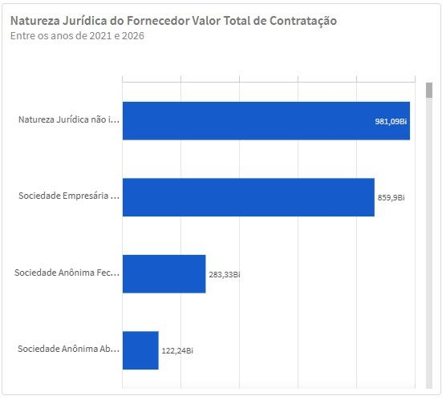

Essa visualização permite compreender quais tipos de natureza jurídica concentram maior volume financeiro nas contratações homologadas, como sociedades empresárias, empresários individuais, entidades públicas, associações ou outras classificações disponíveis na base. Essa leitura contribui para entender o perfil jurídico dos fornecedores que participam das contratações públicas.

---

## Situação da contratação

A visualização de Situação da Contratação é dividida em duas formas de análise:

- Gráfico de barras horizontais com valores em reais (R$)
- Gráfico de rosca com participação percentual

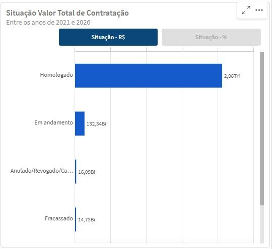

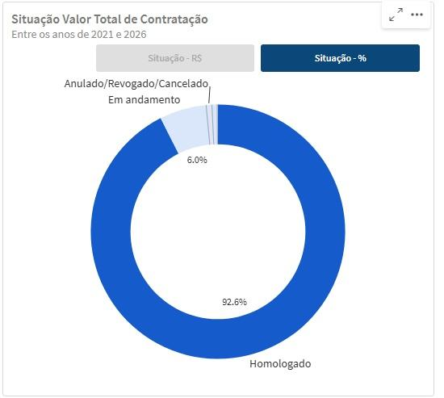

As situações podem incluir:

- Divulgada no PNCP
- Homologado
- Em andamento
- Anulado / Revogado / Cancelado
- Fracassado

Essa análise permite compreender o estado administrativo das contratações homologadas dentro do PNCP, mostrando a distribuição financeira e percentual dos registros conforme sua situação. A visualização auxilia na identificação da predominância de determinadas situações e mantém transparência sobre processos que, mesmo não representando o fluxo final esperado, compõem o histórico auditável das contratações públicas.

---

## Tipo de benefício

A página apresenta o gráfico de Tipo de Benefício associado ao valor da contratação. Essa visualização é dividida em duas formas:

- Gráfico de barras horizontais com valores em reais (R$);
- Gráfico de rosca com participação percentual.

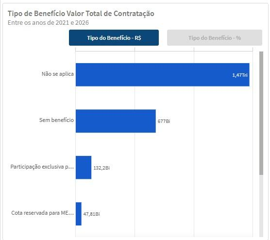

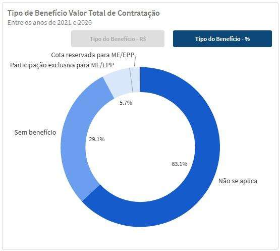

Essa análise permite observar a distribuição dos valores homologados conforme os benefícios aplicados, como benefício ME/EPP, cota reservada, subcontratação ou ausência de benefício, conforme a classificação disponível na base. A leitura contribui para avaliar a presença e a relevância de políticas públicas de incentivo ou tratamento diferenciado nas contratações homologadas.

---

## Porte do fornecedor

A visualização de Porte do Fornecedor também é dividida em duas formas:

- Gráfico de barras horizontais com valores em reais (R$);
- Gráfico de rosca com participação percentual.

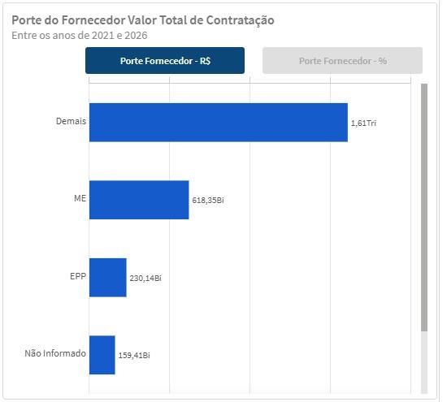

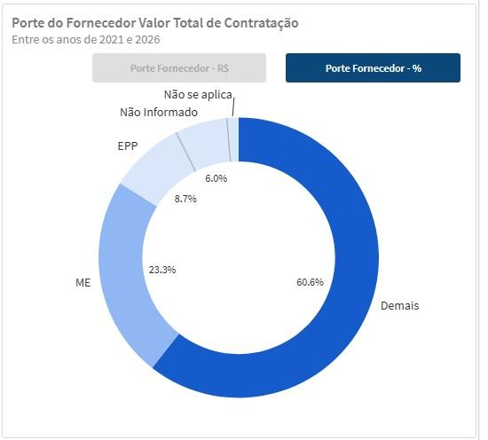

Essa análise permite compreender como o valor homologado se distribui entre fornecedores de diferentes portes, como ME, EPP, MEI, demais empresas ou outras classificações existentes na base. A alternância entre valor absoluto e percentual facilita a comparação entre a participação financeira de cada grupo e sua representatividade dentro do total homologado.

---

## Tabela de contratação por fornecedor contratado

Por último, a página apresenta uma tabela com detalhamento das contratações por fornecedor contratado. A tabela exibe informações como:

- Número da contratação
- Link para o edital no PNCP
- Nome do fornecedor
- Órgão contratante
- Poder
- Município do órgão
- UF do órgão
- Situação da contratação
- Aplicação da margem de preferência

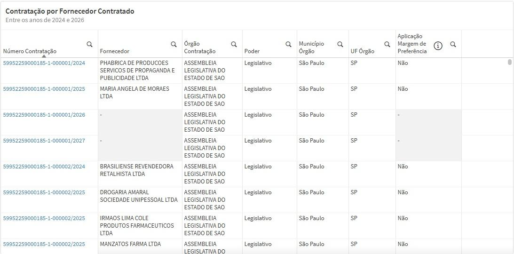

Essa tabela permite sair da visão agregada e consultar informações mais específicas sobre cada contratação homologada e seu respectivo fornecedor. O link para o edital no PNCP garante rastreabilidade e permite consulta direta à fonte oficial.

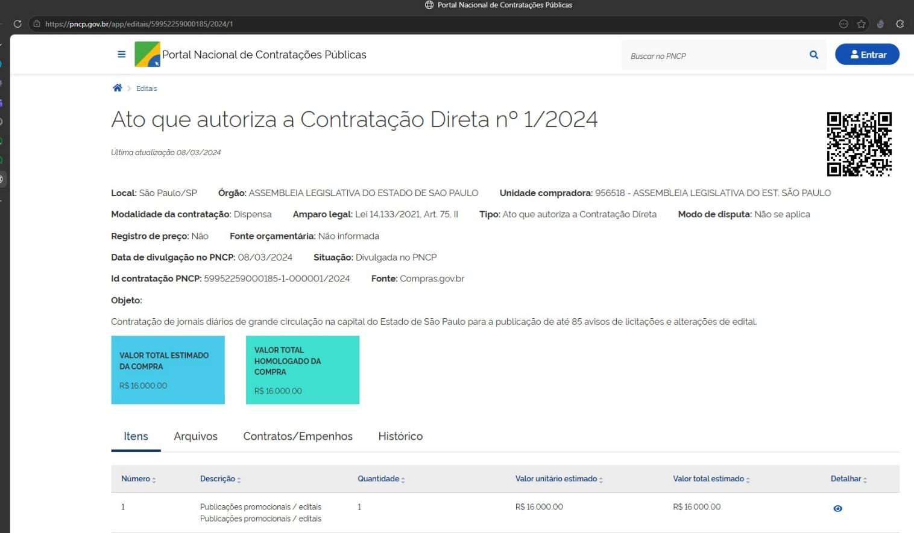

No campo **Aplicação da Margem de Preferência**, há um ícone de informação que abre uma visualização complementar com:

- KPI de valor em reais da margem de preferência
- KPI de percentual do valor com margem de preferência
- Gráfico de rosca com os percentuais de amparo legal da margem de preferência

Essa funcionalidade permite detalhar o uso da margem de preferência sem sobrecarregar a tabela principal, oferecendo uma camada adicional de análise para usuários que desejam aprofundar o entendimento sobre esse instrumento.

<a href="#">⬆️ Voltar ao topo</a>

  <button onclick="window.print()" style="background-color: #0056b3; color: white; padding: 10px 20px; border: none; border-radius: 5px; font-size: 16px; cursor: pointer; box-shadow: 0 2px 4px rgba(0,0,0,0.2);">
    🖨️ Imprimir ou baixar esta página
  </button>

