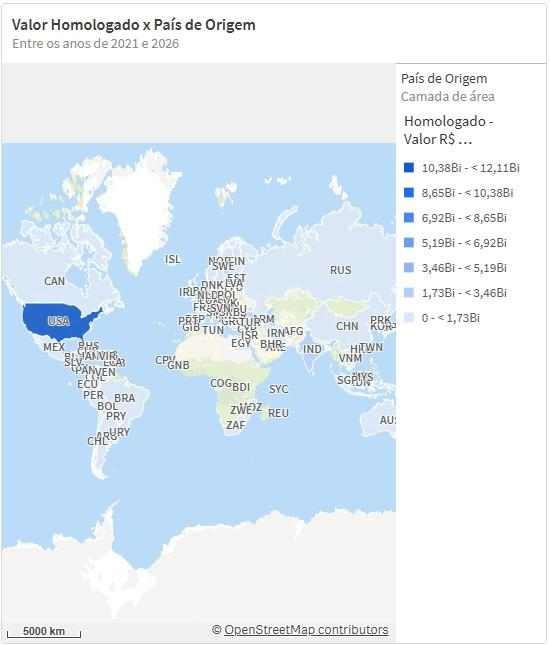
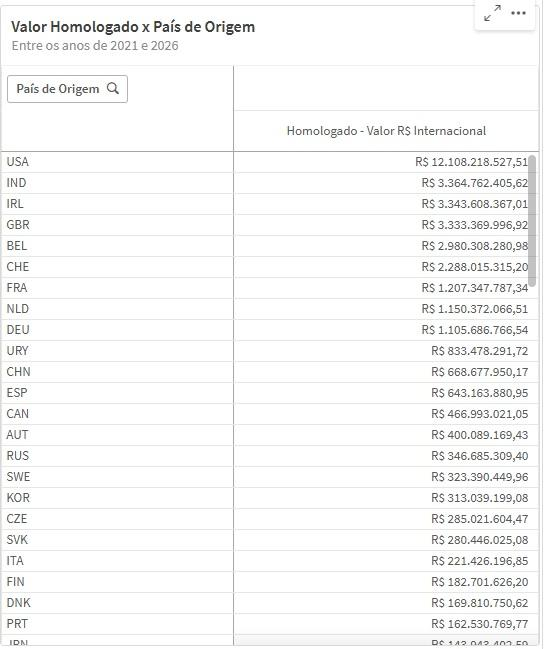
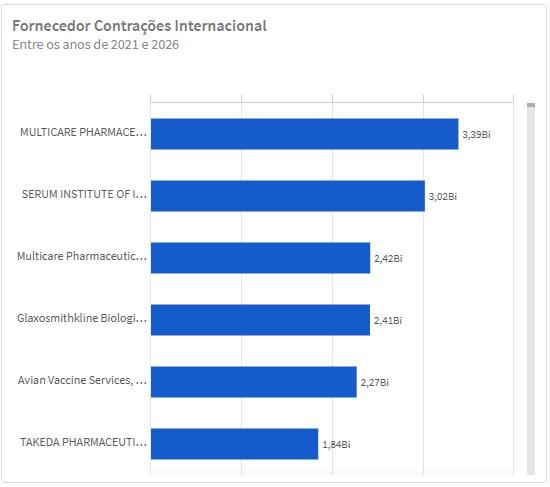

  Tamanho do texto:
  <button onclick="diminuirFonte()" title="Diminuir texto" style="padding: 6px 12px; font-weight: bold; cursor: pointer; border: 1px solid #ccc; border-radius: 4px; background: #f8f9fa;">A-</button>
  <button onclick="resetarFonte()" title="Tamanho normal" style="padding: 6px 12px; font-weight: bold; cursor: pointer; border: 1px solid #ccc; border-radius: 4px; background: #f8f9fa;">A</button>
  <button onclick="aumentarFonte()" title="Aumentar texto" style="padding: 6px 12px; font-weight: bold; cursor: pointer; border: 1px solid #ccc; border-radius: 4px; background: #f8f9fa;">A+</button>
  
  <button onclick="window.print()" style="background-color: #0056b3; color: white; padding: 6px 16px; border: none; border-radius: 5px; font-size: 14px; cursor: pointer; box-shadow: 0 2px 4px rgba(0,0,0,0.2); margin-left: 10px;">
    🖨️ Imprimir ou baixar esta página
  </button>

PÚBLICO-ALVO: ANALISTAS, GESTORES E USUÁRIOS DO PAINEL PNCP EM NÚMEROS

# 12. Indicadores Internacionais Principais

Ao selecionar o botão **Contratações de Fornecedores Internacionais**, a página passa a exibir exclusivamente os valores e quantidades relacionados às contratações homologadas com fornecedores estrangeiros. Essa visualização permite analisar a participação internacional nas contratações públicas registradas no PNCP, destacando os países de origem, os principais fornecedores internacionais e a evolução temporal dos valores homologados.

---

## Distribuição territorial — Mapa coroplético (Internacional)

No modo internacional, é apresentado um mapa coroplético mundial pelo valor homologado.

Nesse mapa, a cor mais escura indica os países com maior concentração financeira de contratos homologados. Essa visualização permite identificar, de forma territorial, quais países possuem maior participação nas contratações públicas brasileiras, oferecendo uma leitura rápida sobre a origem geográfica dos fornecedores internacionais.

---

## Tabela País Valores Homologados

Em seguida, a página apresenta uma tabela com o valor homologado por país, permitindo uma leitura mais objetiva e comparativa da participação de cada país no total contratado.

Essa tabela complementa o mapa ao apresentar os valores de forma ordenada e detalhada, facilitando a identificação dos principais países fornecedores.

---

## Maiores fornecedores contratados (Internacional)

Logo abaixo, há um gráfico de barras horizontais com os maiores fornecedores internacionais por valor homologado em reais (R$).

Essa visualização permite identificar quais fornecedores estrangeiros concentram os maiores valores contratados, contribuindo para a análise de concentração, recorrência e relevância dos principais fornecedores internacionais no conjunto das contratações homologadas.

---

## Tendência temporal das contratações homologadas (Internacional)

Por fim, a página apresenta um gráfico de linha de Valor Total de Contratações x Data de Publicação, permitindo acompanhar a evolução dos valores homologados internacionais ao longo dos anos.

A visualização pode ser alternada entre valores em reais (R$) e quantidade de contratações homologadas, possibilitando analisar tanto o crescimento financeiro quanto o volume de registros associados a fornecedores internacionais.

Essa seção permite compreender a dimensão internacional das contratações públicas, evidenciando quais países e fornecedores estrangeiros possuem maior participação nos resultados homologados. A análise contribui para identificar padrões de contratação internacional, concentração por país, principais fornecedores e evolução histórica desse tipo de contratação dentro do PNCP.

<a href="#">⬆️ Voltar ao topo</a>

  <button onclick="window.print()" style="background-color: #0056b3; color: white; padding: 10px 20px; border: none; border-radius: 5px; font-size: 16px; cursor: pointer; box-shadow: 0 2px 4px rgba(0,0,0,0.2);">
    🖨️ Imprimir ou baixar esta página
  </button>

